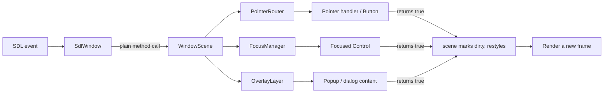

# How input reaches a Control

This is the short version. Every event takes the same three steps:

1. **The platform window** (today `SdlWindow`) receives an SDL event and turns it into a plain call on the `WindowScene`.
2. **The window scene** decides who gets it: an overlay, the pointer router, the focus manager.
3. **The Control** reacts. Every call returns `true` when something changed, and then the scene restyles, marks itself dirty and the window draws a new frame.

Nothing below `WindowScene` knows about SDL, so every step after the first can be tested with plain calls and a manual clock.

## Who does what

| Piece | Job |
| --- | --- |
| `SdlWindow` | Translates SDL events and modifier keys into scene calls. Draws the display list the scene returns. |
| `WindowScene` | The runtime of one window: owns the router, focus, overlays, tooltips, toasts and animations. |
| `PointerRouter` | Works out which Control is under the pointer, tracks hover and press, and delivers pointer events. |
| `FocusManager` | Remembers which Control has the keyboard and hands it keys and typed text. |
| `OverlayLayer` | Holds popups, menus and dialogs above the tree. It is asked first. |

## The rule of thumb

- **Pointer events go to what is under the pointer.** The innermost Control that handles the pointer wins.
- **Keyboard events go to what has the focus.** A press moves the focus; nothing else does, except code that calls `Focus(...)`.
- **Overlays come first** in both cases: Escape closes the top overlay before anything else, and a press outside the top overlay closes it and goes no further.

See [mouse-flow.md](mouse-flow.md) and [keyboard-flow.md](keyboard-flow.md) for each path in detail.
