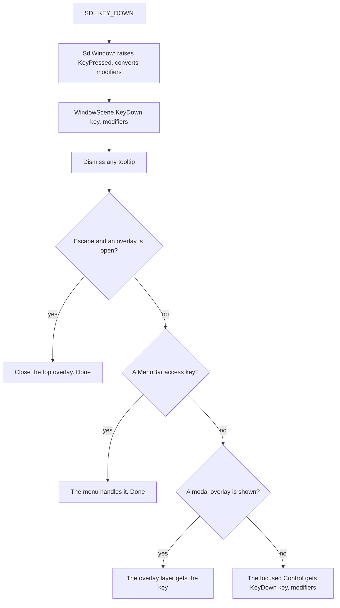
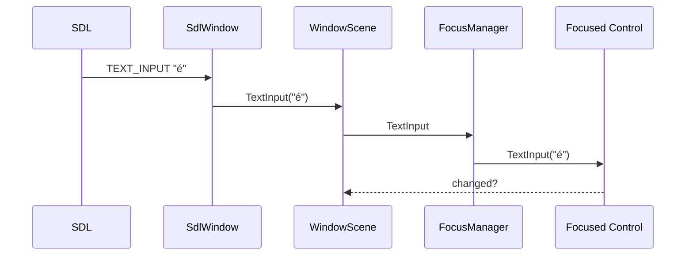

# Keyboard and text input flow

Keys and typed text are two separate events. A key press says which key went down; text input says which characters it produced, after the keyboard layout and shift state were applied.

## Key press

- **Order matters:** Escape and menu access keys beat everything. While a modal dialog is open, it takes every other key, so the controls behind it never see them.
- **Modifiers** are `Shift`, `Control` and `Alt`. The Command key on a Mac counts as `Control`.
- `Control.KeyDown(key, modifiers)` defaults to `KeyDown(key)`, so a Control that does not need modifiers overrides only the simple one. `TextBox` and `TextArea` use the modifiers for selection, undo and the clipboard.

## Text input

Text input goes straight to the focused Control. Controls that edit text drop control characters from it.

## How a Control gets the focus

- A Control is **focusable** when it says so (`IsFocusable`): text boxes, buttons, sliders and so on.
- A **primary press** moves the focus to the nearest focusable Control at or above the one that was pressed. A press anywhere else clears it. A `Label` with `For` hands the focus to the Control it names.
- The focused Control has the `focus` Pseudo-state, which Stylesheets can match (`&:focus`).
- **A modal overlay blocks focus changes:** presses under it do not move the keyboard.
- Code can move it directly with `scene.Focus(control)`.

## Where to look in the code

- `src/Silo.Controls/FocusManager.cs` – who has the keyboard
- `src/Silo.Controls/WindowScene.cs` – `KeyDown` and `TextInput`, and the order above
- `src/Silo.Controls/KeyModifiers.cs` and `Key.cs` – the key vocabulary
- `src/Silo.Platform.Sdl/SdlWindow.cs` – `PressKey` and the SDL key conversion
