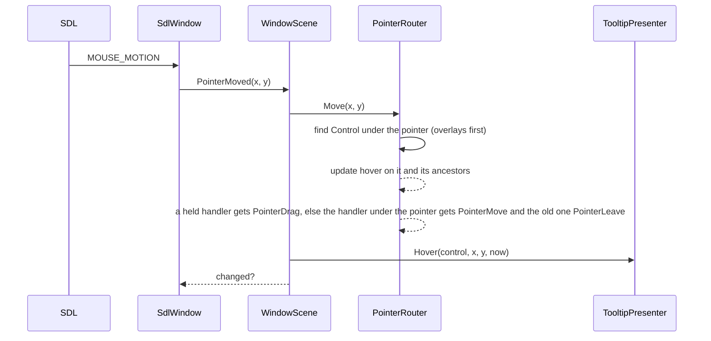
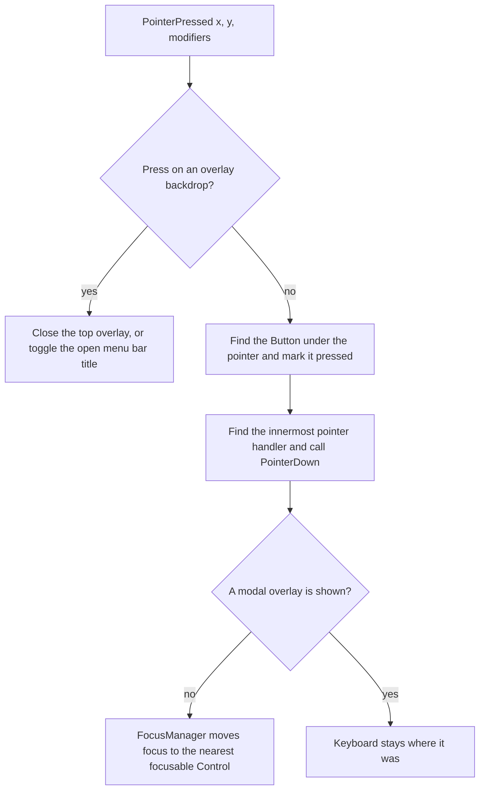
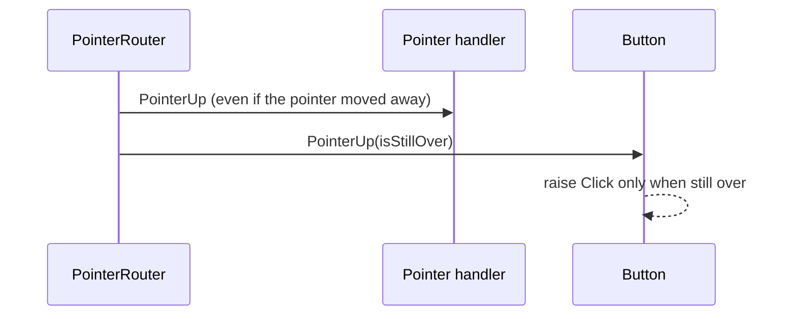

# Mouse and pointer flow

All positions are in window coordinates. The scene passes them to the `PointerRouter`, which turns them into Control-local coordinates before it calls a Control.

## Move

- **Hover** is a Pseudo-state on the Control under the pointer and on every ancestor.
- **A drag** is a move while a press is held: the handler that got the press keeps the pointer until release, even if the pointer leaves it.
- **Tooltips** start a delay timer; the scene's `Tick()` shows them later.
- `WINDOW_MOUSE_LEAVE` calls `PointerLeft()`, which clears hover and dismisses tooltips.

## Press (primary button)

- A **pointer handler** is a Control that implements `IPointerHandler` (sliders, list views, text boxes, scroll bars and so on). It receives `PointerDown`, then `PointerDrag` while held, then `PointerUp`.
- A **Button** is tracked separately: it shows the `pressed` Pseudo-state while held.

## Release

`PointerReleased` calls `PointerUp` on the handler that got the press, then on the Button. The Button raises `Click` only if the pointer is still over **the same Button** it went down on.

## Right button

`SecondaryPressed` finds the nearest ancestor of the hovered Control with a `ContextMenu` and shows it at the pointer. Like a primary press, a press outside the top overlay only closes it.

## Mouse wheel

`Wheel` dismisses tooltips, then walks up from the Control under the pointer to the first `IScrollable` that actually scrolls. If none scrolls, the wheel is ignored.

## Where to look in the code

- `src/Silo.Controls/PointerRouter.cs` – hover, press, drag, release, wheel
- `src/Silo.Controls/IPointerHandler.cs` and `PointerEvent.cs` – what a Control implements and receives
- `src/Silo.Controls/WindowScene.cs` – the entry points the platform window calls
- `src/Silo.Platform.Sdl/SdlWindow.cs` – the SDL event switch
