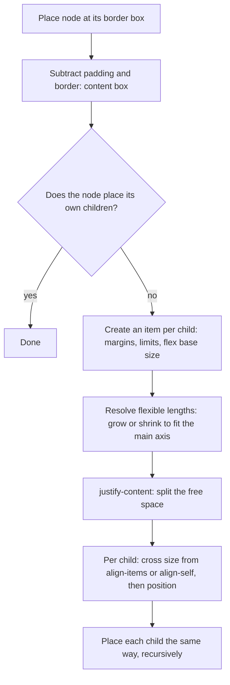
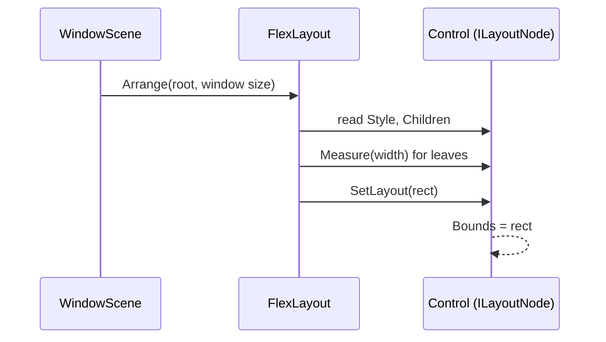

# Layout: how a Control gets its size and position

Layout turns Styled property values (`width`, `padding`, `gap`, `align-items`, ...) into a `Bounds` rectangle for every Control. The engine is `FlexLayout` in `Silo.Layout`. It is a pure function of the tree and the available size: no window, no Skia.

## The model

- **Border box.** `width` and `height` include padding and border, as if `box-sizing: border-box` was set everywhere.
- **Flexbox**, one line: a container has a main axis (`row` or `column`) and lays its children out along it.
- **`null` means auto.** A Control without a `width` takes what its content or its flex settings give it.
- `Bounds` is **relative to the parent's border box**. A Control draws with its parent's origin as (0, 0).

Supported: direction, `gap`, `flex-grow`, `flex-shrink`, `flex-basis`, `justify-content`, `align-items`, `align-self`, min and max sizes, padding, border and margin. Not yet: wrapping, reverse directions, auto margins, grid.

## The algorithm for one container

1. **Flex base size**: the child's `flex-basis`, else its `width` or `height`, else its content size (`Measure`).
2. **Grow or shrink**: if the children are smaller than the container, free space is handed out by `flex-grow`. If they are bigger, the overflow is taken back by `flex-shrink` times base size. Min and max sizes freeze an item at its limit and the rest is shared again.
3. **Justify**: leftover space is placed at the start, middle or end, or between and around the children.
4. **Align**: on the cross axis, `stretch` (the default) fills the container when the child has no cross size. `start`, `center` and `end` place it.

## Leaves and content size

A Control with no children is a **leaf**. The engine asks it `Measure(availableWidth)`:

- Text asks the `ITextMeasurer` how big its text is. With a width it wraps, so height depends on width.
- A `null` width asks for the natural, unwrapped width.

Padding and border are not part of what `Measure` returns. The engine adds them.

## Where `Bounds` goes

`Control` implements `ILayoutNode` by reading its Styled properties, so the engine never knows about Controls. Any tree of `ILayoutNode` can be laid out in a test, which is how the engine is tested.

## Two escape hatches

- **`PlaceChildren(content)`**: a Control positions its own children and tells the engine to skip them. `GalleryView` and virtualized lists use it because they only create the rows that are visible.
- **Out of flow**: a Control can say `IsInFlow(child) == false` for some child. Those children are left out of the flex pass, as overlays and drop-downs need.

## Practical tips

- A root with no size fills the window. Give a list or tree a `height`, or it is as tall as all its content.
- If a child ignores `align-items: stretch`, check whether it has a cross size. A set `width` or `height` wins over stretching.
- Ask `Bounds` after `Arrange`, never before.
- Percent sizes resolve against the parent's **content box**.

## Where to look in the code

- `src/Silo.Layout/FlexLayout.cs`: `Arrange`, `Place`, `ResolveFlexibleLengths`
- `src/Silo.Layout/LayoutStyle.cs` and `ILayoutNode.cs`: what the engine reads
- `src/Silo.Controls/Control.cs`: the `ILayoutNode` implementation and `PlaceChildren`
