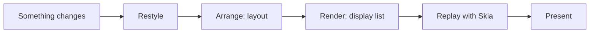

# The frame pipeline

How a change in the app becomes pixels. One frame has four steps, and the window scene decides when to run them.



| Step | Who | What happens |
| --- | --- | --- |
| Restyle | `Element.ApplyStyles` | Every Element gets its Styled property values from the Stylesheets. See [the cascade](../styling/cascade.md). |
| Arrange | `Control.Arrange` → `FlexLayout` | Every Control gets its `Bounds`. See [layout](../layout/flex-layout.md). |
| Render | `Control.Render` | Every Control draws into a `DisplayListBuilder`, which records commands. Nothing is painted yet. |
| Replay and present | `SdlWindow.Draw` | The immutable `DisplayList` is replayed on a Skia canvas and the bitmap is shown. |

The first three are platform-free and live in `WindowScene`. Only the last one needs SDL and Skia.

## When does a frame happen?

A frame is only drawn when the scene is **dirty**. The scene becomes dirty when:

- an input call returns `true` (a hover, a press, a key, a scroll),
- the Stylesheets change (`Styles = ...`),
- an overlay opens or closes,
- `Invalidate()` or `Restyle()` is called,
- `Tick()` finds a tooltip, a toast or an animation that needs one.

`Render(size)` clears the dirty flag. It returns `null` when the window has no area (for example while minimized), so nothing is drawn.

## The event loop in one picture

```mermaid
sequenceDiagram
  participant Loop as SdlWindow loop
  participant Scene as WindowScene
  Loop->>Scene: input calls (PointerMoved, KeyDown, ...)
  Scene-->>Loop: true = something changed
  Loop->>Scene: Tick()
  Scene-->>Loop: dirty?
  alt dirty
    Loop->>Scene: Render(size)
    Scene-->>Loop: DisplayList
    Loop->>Loop: replay with Skia, present
  end
  Loop->>Scene: DueIn()
  Scene-->>Loop: how long to sleep
```

- `Tick()` lets time pass: tooltips appear, toasts run out, animations move one step.
- `DueIn()` says how long the loop may sleep: until the next tooltip or toast is due, or one frame time while something animates, or forever when nothing waits. An idle window uses no CPU.

## Animation and the frame

While an animation or transition runs, the scene is **animating**: each `Tick()` marks it dirty and steps the `AnimationScheduler`, which restyles. `DueIn()` then returns one frame time (16 ms by default). When the last animation ends, the scene stops asking for frames.

## Why a display list?

The display list is a plain list of draw commands (`FillRectCommand`, `DrawTextCommand`, ...). It is immutable once built, which gives three things:

- **Tests** can look at what was drawn without a window or a GPU.
- **Any backend** can replay it. Only `Silo.Rendering.Skia` knows about Skia.
- **A render thread** can take it later: the UI thread builds it, another thread draws it. Today replay runs on the same thread.

## Where to look in the code

- `src/Silo.Controls/WindowScene.cs`: `Restyle`, `Tick`, `DueIn`, `Render`
- `src/Silo.Controls/Control.cs`: `Arrange`, `Render`, `OnRender`
- `src/Silo.Rendering/DisplayList.cs`: the builder and the list
- `src/Silo.Platform.Sdl/SdlWindow.cs`: `Draw`, the loop and `Pump`
