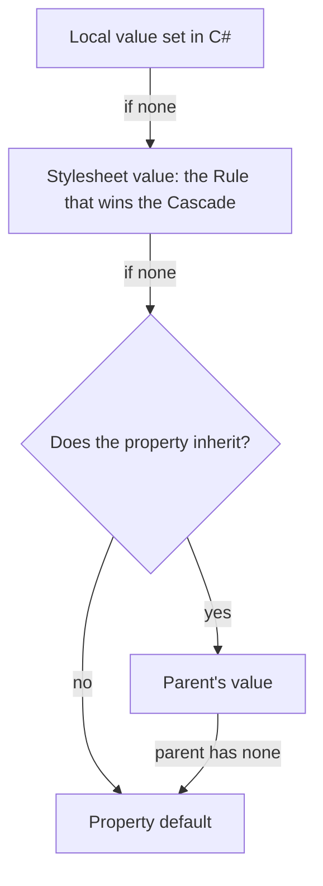
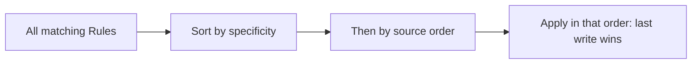

# The cascade: how a property gets its value

Every Styled property on every Element ends up with one value. This page explains how, from the highest priority to the lowest.



1. **Local value**: `button.Color = ...` in C#. It beats every Stylesheet.
2. **Stylesheet value**: the winning Declaration among all Rules that match the Element.
3. **Inherited value**: only for a small whitelist of properties (text color, font settings).
4. **Default**: what the property was registered with.

## Which Rule wins

A Rule is a Selector plus Declarations:

```jsonc
{
  "rules": {
    "Button": { "background": "gray" },
    "Button.primary": { "background": "var(--accent)" },
    "Button.primary:hover": { "background": "var(--accent-hover)" }
  }
}
```

For one Element, the resolver collects **every Rule whose Selector matches** and sorts them from weakest to strongest. Later Declarations replace earlier ones, property by property.



- **Specificity** is compared like CSS: ids (`#save`) beat classes and Pseudo-states (`.primary`, `:hover`), which beat type names (`Button`). One class beats any number of types.
- **Source order** breaks ties: a Rule in a later Stylesheet beats a Rule in an earlier one, and a later Rule in the same Stylesheet beats an earlier one. That is how an app overrides the Default theme: it loads after it.
- There is **no `!important`**.
- A Rule only sets the properties it declares, so a more specific Rule never wipes out the rest of a weaker one.

### Selectors that exist

Type (`Button`), class (`.primary`), name (`#save`), Pseudo-state (`:hover`, `:focus`, `:pressed`, ...), descendant (`.card Button`), child (`Box > Button`), the universal `*`, and `::part(name)` for the inside of a Control.

## Tokens

A Token is a named value starting with `--`. Reference it with `var(--name)` or `var(--name, fallback)`.

```jsonc
{
  "tokens": { "--accent": "#3b82f6" },
  "rules": {
    "Button.primary": { "background": "var(--accent)" },
    ".danger": { "--accent": "#dc2626" }
  }
}
```

- Tokens **inherit down the tree**. `.danger` redeclares `--accent`, so every Button below an Element with that class sees the red one.
- At each Element the resolver walks from the root down. Top-level Tokens come first, then the Tokens from Rules matching each Element on the way, so the closest declaration wins.
- A Token may refer to another Token. A missing Token without a fallback is a diagnostic. A cycle is cut off at 32 levels and reported.

## From text to value: the stages

| Stage | Meaning | Example for `background` |
| --- | --- | --- |
| Declared | What a Rule wrote | `var(--accent)` |
| Cascaded | The Declared value that won (or the Local value) | `var(--accent)` |
| Computed | Tokens substituted, then parsed | `#3b82f6` |
| Used | After layout, with percentages resolved | (for sizes) `120px` |

A value that cannot be resolved or parsed does not stop styling. It becomes a `StyleDiagnostic` with the file and position of the Declaration, and the property falls back to the next level.

## Theme variants

A Theme is an ordered list of Stylesheets. A **Theme variant** (Light, Dark) is a Stylesheet that overrides the Theme's Tokens:

```csharp
var resolver = new StyleResolver([.. DefaultTheme.Load(ThemeVariant.Dark), myOverrides]);
```

Dark is the Default theme plus `dark.jsonc`, which only redeclares Tokens. Because every Rule uses `var(--...)`, switching the variant restyles the whole tree without touching a single Rule.

## When styles are applied

`Element.ApplyStyles(resolver)` walks the tree from the root, and for each Element: cascades, resolves Tokens, parses values, stores them, and calls `OnPropertyChanged` for properties that changed (which starts a transition if the Element has one). The window scene calls it again whenever a Pseudo-state, a Class or the Stylesheets change, then asks for a new frame.

## Trace one property

Why is this Button red when hovered?

1. Collect matching Rules for the Button, in the `:hover` Pseudo-state: `Button` (0,0,1), `Button.primary` (0,1,1), `Button.primary:hover` (0,2,1).
2. Sort by specificity. The last Rule that declares `background` wins: `Button.primary:hover`.
3. Resolve Tokens at the Button. A `.danger` parent redeclared `--accent`, so `var(--accent-hover)` reads that.
4. Parse the text as a Color and store it. This is also what the Inspector's Cascade trace shows: the winning Rule, its file and line, and the values it beat.

## Where to look in the code

- `src/Silo.Styling/Cascade.cs`: `StyleResolver` (`Cascade`, `ResolveTokens`, `Compute`)
- `src/Silo.Styling/Selector.cs`: matching and specificity
- `src/Silo.Core/Element.cs`: `ApplyStyles`, `GetObject` (the priority list above)
- `src/Silo.Themes.Default/`: the Default theme and `ThemeVariant`
